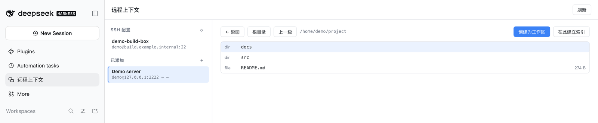
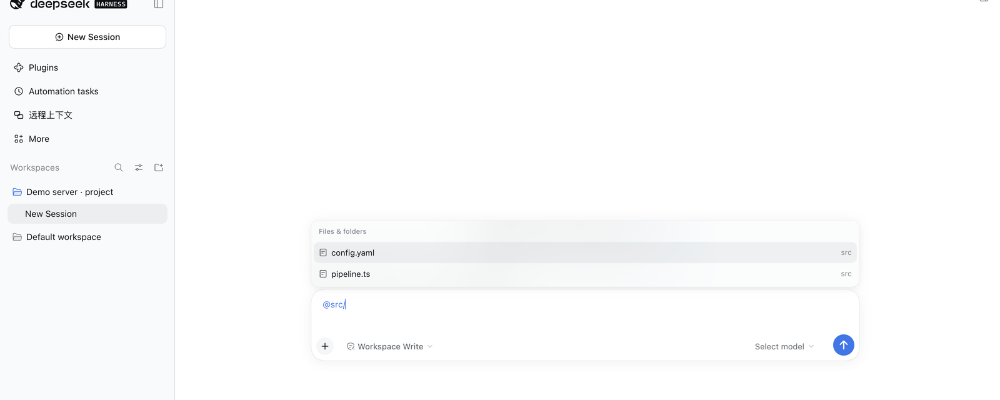

<div align="center">

# dsh-remote-ctx

**只靠一条 SSH，就把工作区文件放到远端；随后像本地文件一样列出、读写、关联和索引它们。Agent、会话与 `$DSH_HOME` 仍然留在本机。**

[English](./README.md) · [安装](#安装) · [快速上手](#快速上手) · [安全策略](./SECURITY.md) · [架构](./docs/architecture.md) · [更新日志](./CHANGELOG.md)

[](https://www.npmjs.com/package/dsh-remote-ctx)
[](https://www.npmjs.com/package/dsh-remote-ctx)
[](./LICENSE)
[](#兼容性)
[](#兼容性)
[](./test)

</div>

`dsh-remote-ctx` 是一个 DeepSeek Harness 插件，只做一件事：把远端工作区的文件接入本地上下文。它把远程连接压到最小——**只需要一次 SSH 登录**。目标端不需要装 DSH、不需要 CLI、不需要 helper 程序，也不需要守护进程；OpenSSH 自带的 SFTP 子系统就是全部契约。

文件的列出、读取、写入、镜像与索引都走这条通道，所以模型可以像操作本地目录一样操作远端目录，而 agent、会话、工作区元数据全部留在本机。

如果你想要的是「文件在那边，agent 在这边」，这个插件就是答案。

---

## 界面预览

面板：`~/.ssh/config` 里已有的 `Host`、由它保存的连接，以及一个一键就能变成工作区的远端目录。



在由远端目录创建的工作区里，`@` 补全列出的是目标机上真实存在的文件——名字来自锚点的占位清单，内容仍由 `remote_ctx_read` 读取。



## 为什么需要它

DSH 默认工作区在本地磁盘。远端机器——构建机、家里的服务器、局域网里的笔记本——原本够不着，除非在那边装点东西，或者把整个目录来回拷贝。

这个插件只取这个问题里最窄但最有用的一片：

| 需求 | `dsh-remote-ctx` 的做法 |
| --- | --- |
| 文件在另一台机器上 | 复用你已有的 SSH 连接，走 SFTP |
| 模型要像本地一样操作 | `remote_ctx_*` 工具，路径语义一致；本地缓存索引负责搜索 |
| 工作区要能方便地送过去 | 一条 `remote_ctx_sync` 推送，只用 SFTP |
| 目标端不装任何新东西 | 无 CLI、无守护进程、无 agent、远端无 DSH |
| Agent、会话、历史都留在本地 | 是的，只有文件字节过网 |

## 它是什么，不是什么

**它是**远程上下文的桥：文件、目录列表、搜索、小型镜像，以及一个侧栏面板。

**它不是**远程 shell。目标端不执行命令，没有 PTY，不跑 git，不跑构建。需要这些能力时用 [`dsh-remote-ssh`](https://github.com/Roshenn/dsh-remote-ssh)，那个插件替换 `ctx.fs` / `ctx.subprocess`，命令真的在远端跑。两者可以并存安装。

## 特性

- **目标端只要 SSH。** SFTP 是 OpenSSH 自带组件，除此之外什么都不用装。
- **远端目录可以直接变成工作区。** 点 **创建为工作区**，或调 `remote_ctx_workspace`，
  就会用一个本地锚点注册 DSH 工作区；锚点里的 `AGENTS.md` 告诉 agent 文件在远端、
  要用 `remote_ctx_*` 工具，于是会话与历史留在本地，文件留在目标机。锚点同时会生成一份远端树的占位清单，`@` 文件补全与工作区文件面板因此能看到远端路径；内容仍由 `remote_ctx_read` 读取。重跑该工具、`remote_ctx_index`、任意 `remote_ctx_write` 或一次 push 都会刷新这份清单，之后在目标机上新建的文件也能被 `@` 看到。
- **直接吃你的 `~/.ssh/config`。** 面板列出每个具体 `Host` 的主机名、用户、端口和密钥，点一下就把参数填进连接表单——已经配好的东西不用再手填一遍。
- **路径约束是构造出来的。** 每个远端路径在到达 SFTP 之前都被规范化，并证明落在连接的 `remoteRoot` 之内——模型参数和 HTTP 请求体同样适用。
- **索引在本地，文件在远端。** 远端树只走一次，缓存在 `$DSH_HOME/remote-ctx/index/`；搜索在本地跑，只有内容检索才会按需回读远端文本文件。
- **原子写入。** 先写临时文件再 rename；写失败不会留下半截文件。
- **不会删除的镜像。** 本地推远端、远端拉本地；按大小比对，`force` 表示「我确定要重传」，`dryRun` 先看计划。
- **连接是懒加载的。** 每个连接一个池化 SFTP 会话，带 keepalive，空闲超时后关闭；没有工具调用就不会建立 SSH 连接。
- **密钥留在本地。** 密码以 0600 存在 `$DSH_HOME` 下，工具返回值与浏览器都拿不到它。
- **零构建。** 纯 ESM；唯一依赖是 `ssh2`，且只在需要时加载。

## 工具

| 工具 | 作用 | 主要参数 |
| --- | --- | --- |
| `remote_ctx_connections` | 列出 / 新增 / 修改 / 删除 / 测试 / 发现 / 导入 SSH 连接 | `action`、`id`、`host?`、`port?`、`username?`、`privateKeyPath?`、`password?`、`agentSocket?`、`remoteRoot?`、`localWorkspace?` |
| `remote_ctx_workspace` | 用本地锚点把远端目录注册成 DSH 工作区 | `connection`、`path?`、`title?` |
| `remote_ctx_ls` | 列出一个远端目录：类型、大小、修改时间 | `connection`、`path?`、`limit?` |
| `remote_ctx_read` | 读取远端文本文件，有上限并标注是否截断 | `connection`、`path`、`limit?` |
| `remote_ctx_write` | 在远端根目录内做原子写入 | `connection`、`path`、`content` |
| `remote_ctx_index` | 遍历远端根目录，把文件索引缓存到本地 | `connection`、`refresh?`、`maxDepth?`、`maxFiles?` |
| `remote_ctx_find` | 按路径 / 文件名 / glob / 内容检索索引 | `connection`、`query`、`mode?`、`type?`、`limit?`、`refresh?` |
| `remote_ctx_sync` | 本地工作区镜像到远端，或反向拉回 | `connection`、`direction?`、`localRoot?`、`path?`、`dryRun?`、`force?` |

只配置了一个连接时，`connection` 可以省略。

## 安装

需要 Node.js `>= 22.13`、DSH `>= 0.2.1-rc.1`，以及目标端一个启用了 SFTP 子系统的 SSH 账号。

```bash
# 直接从仓库安装（现在可用）
dsh plugin --profile web add github:Roshenn/dsh-remote-ctx

# 从本地目录安装
dsh plugin --profile web add ./dsh-remote-ctx

# npm 发版之后
npx -y @deepseek-ai/dsh plugin --profile web add dsh-remote-ctx@0.2.0
```

然后重启 `dsh web`（只刷新页面不会加载新插件代码）。

确认插件行已挂载：

```bash
dsh --profile web --dump-config | grep remote-ctx
```

**桌面端：** `desktop` profile 由桌面外壳管理，CLI 拒绝写入；请在应用里打开 **Plugins → Add plugin**，填同一个包名。

**目标端：** 什么都不用装。不确定 SFTP 是否可用时：

```bash
ssh you@host 'echo $SHELL; ls -d ~'
```

### 交给你的 agent 装

> 读 https://github.com/Roshenn/dsh-remote-ctx 的 INSTALL.md 并照做，然后跑一次 smoke 检查，把结果告诉我。

### 本地开发（linked checkout）

`dsh plugin` 管不了 `desktop` profile，而且开发时你要让运行中的应用加载磁盘上的仓库而不是发布副本。所以开发安装用的是和 `dsh-looptree-dashboard` 一样的形态：profile 清单里一条 `link:` 依赖加一条 bundle 条目。一条命令幂等地完成这两处修改：

```bash
node scripts/dev-link.mjs --profile "$DSH_HOME/profiles/desktop"
```

然后装两次——一次在 profile，一次在本仓库：

```bash
cd "$DSH_HOME/profiles/desktop" && pnpm install --prefer-offline
cd /path/to/dsh-remote-ctx && npm install --no-package-lock
```

第二次不是可选的：**linked checkout 保留自己的 `node_modules`**，profile 的安装不会替这个包装 `ssh2`。缺了它插件照样加载、工具照样能用，但每次连接都会以 `SSH2_MISSING` 失败。

完全退出并重启 DeepSeek Harness——刷新页面不会加载新插件代码。侧栏随后应出现 **Remote context**。

`--dry-run` 只打印将要写入的清单，`--remove` 撤销两处修改，`--install` 顺手帮你跑 profile 的 `pnpm install`。

| 文件 | 修改 |
| --- | --- |
| `profiles/desktop/package.json` | `"dsh-remote-ctx": "link:../../dsh-remote-ctx"` |
| `profiles/desktop/package.json` | 向 `dsh.profile.bundles` 追加 `dsh-remote-ctx` |

## 快速上手

1. 打开侧栏 **远程上下文**。页面是左右两栏：左侧 **SSH 配置** 列出 `~/.ssh/config` 里每个具体 `Host`，右侧 **新建连接** 表单已经打开。点左侧主机只会预填表单，点 **连接** 才真正保存。
2. 点 **Test**，成功会报告远端 home 与 root。
3. 点 **Browse** 浏览远端目录，再点 **Index here** 建立索引。
4. 在对话里问：*「远端工作区里有哪些文件？找出出现 DATABASE_URL 的那个配置。」*
5. 想把当前本地工作区送过去，点 **Mirror**，先勾 `dry run` 看计划，再正式执行。

一次典型的 agent 会话：

```
> 连上局域网那台机器的工作区，找出重试预算是哪里配置的。

  remote_ctx_connections  action=list
  remote_ctx_index        connection=lan
  remote_ctx_find         connection=lan query="retry" mode=content
  remote_ctx_read         connection=lan path=src/config/retry.ts
```

## 配置

默认值在 [`cordis.patch.yml`](./cordis.patch.yml)。patch 加载器会整体替换某一行的 `config`，不做深合并——需要的字段请全部写出来。

| 字段 | 默认值 | 含义 |
| --- | --- | --- |
| `connectionsFile` | `$DSH_HOME/remote-ctx/connections.json` | 连接记录文件（0600 写入） |
| `indexDir` | `$DSH_HOME/remote-ctx/index` | 索引缓存目录 |
| `connectTimeoutMs` | `15000` | 建立 SSH 连接的超时预算 |
| `keepaliveIntervalMs` | `15000` | 空闲连接的 keepalive 间隔 |
| `idleTtlMs` | `180000` | 池化连接空闲多久后关闭 |
| `maxIndexFiles` | `20000` | 单次遍历文件数上限 |
| `maxIndexDepth` | `8` | 单次遍历深度上限 |
| `maxReadBytes` | `262144` | 单文件默认读取预算 |
| `sshConfigFile` | `~/.ssh/config` | 左栏读取 `Host` 条目的位置 |
| `workspacesDir` | `$DSH_HOME/remote-ctx/workspaces` | 承载远端工作区的本地锚点目录 |
| `allowRemoteWrite` | `true` | 设为 `false` 变成只读安装 |

连接也可以手写文件，扁平结构与 `$DSH_HOME/dsh-ssh-connections.json` 兼容：

```json
{
  "version": 1,
  "connections": [
    {
      "id": "lan",
      "label": "局域网构建机",
      "host": "192.168.1.20",
      "port": 22,
      "username": "builder",
      "auth": { "kind": "key", "privateKeyPath": "~/.ssh/id_ed25519" },
      "remoteRoot": "/srv/workspaces/app",
      "localWorkspace": "/home/me/app"
    }
  ]
}
```

## 工作原理

```
 本机                                         远端
┌──────────────────────────────┐              ┌──────────────────────────┐
│  dsh web + agent + 会话       │              │  sshd                    │
│  ┌────────────────────────┐  │    SSH       │  └─ sftp 子系统          │
│  │ dsh-remote-ctx（host）  │──┼─────────────▶│      └─ 工作区目录树     │
│  │  · 路径约束             │  │  （仅 SFTP） │                          │
│  │  · 本地索引缓存         │◀─┼──────────────│  无 CLI、无守护进程、    │
│  │  · 镜像计划             │  │              │  无 DSH、无 agent        │
│  └────────────────────────┘  │              └──────────────────────────┘
│  $DSH_HOME/remote-ctx/       │
└──────────────────────────────┘
```

host 半在 `tools` 服务上注册七个工具；发现 web server 时再挂一条 `/remote-ctx` 前缀路由给面板。每个连接一个池化的 `RemoteFs`，它独占 SFTP 通道；其上的一切——遍历器、索引器、镜像器、工具、HTTP——都与传输无关，这也是测试可以在没有网络的情况下用内存适配器跑通整条链路的原因。详见 [`docs/architecture.md`](./docs/architecture.md)。

## 排障

| 现象 | 原因 | 处理 |
| --- | --- | --- |
| `SSH_AUTH_FAILED` — 服务器拒绝所有方式 | 导入的公钥不在 `authorized_keys`、密码错误，或该账号不允许登录 | 用终端跑同样的 `ssh user@host`；如果它也失败，就是服务端问题（`ssh-copy-id`），或在连接里改成密码认证 |
| `SSH_KEY_UNREADABLE` — 找不到私钥 / 需要口令 | 私钥路径读的是**本机**文件；加密私钥需要口令 | 改路径，或在编辑表单填「密钥口令」 |
| `SSH_AGENT_MISSING` | agent 认证需要 `SSH_AUTH_SOCK`；Windows 的 OpenSSH agent 是命名管道，ssh2 打不开 | 改用私钥或密码 |
| `SSH_SFTP_UNAVAILABLE` | 服务器关闭了 SFTP 子系统 | 在 `sshd_config` 打开 `Subsystem sftp` |
| `@` 只列出 `AGENTS.md` 与 `remote-ctx.json` | 锚点里没有清单，或远端遍历被截断 | 对同一目录再点一次 **创建为工作区** 重建清单；若提示截断就调大 `maxIndexFiles` |
| 局域网主机超时 | 网络不对或 VPN 没连 | 在同一台机器上先跑 `ssh user@host` |

想知道服务器允许哪些方式：`ssh -v user@host true` 会打印
`Authentications that can continue: …`。插件不猜：它只试连接上配置的方法，并原样报告被拒原因。
## 安全边界

- **主机密钥：** 没有配置 `hostFingerprint` 时，`ssh2` 接受任意主机密钥。可信局域网之外请务必固定指纹。
- **remote root 是路径契约，不是服务端沙箱。** 插件拒绝逃逸根目录的路径，但无法改变目标端解析符号链接的方式。真要隔离，用受限密钥或 chroot 的 SFTP 子系统。
- **永不删除。** 两个方向的镜像都只新增或覆盖。
- **「未变化」按大小判断。** v0.1 没有内容哈希；同大小内容改动需要用 `force`。
- **审批不会隔离插件代码。** 插件以你的权限运行，只安装你信任的。

完整策略与漏洞报告流程见 [`SECURITY.md`](./SECURITY.md)。

## 兼容性

| | |
| --- | --- |
| DSH | `>= 0.2.1-rc.1` |
| Node.js | `>= 22.13` |
| 平台 | Windows、macOS、Linux（`ssh2` 能跑的地方） |
| 目标端 | 任何启用 SFTP 子系统的 SSH 服务（OpenSSH 默认开启） |
| 形态 | host 工具 + 浏览器面板（`dsh.client.platform: web`） |
| 运行时依赖 | `ssh2 ^1.17`（懒加载） |

## 设计参考

本项目的结构对照了在 DSH 生态里被验证过的插件，并明确写出借鉴了什么：

| 参考对象 | 借鉴内容 |
| --- | --- |
| [liustack/modsearch](https://github.com/liustack/modsearch) | README 骨架：标语 → 徽章 → 特性 → 安装矩阵 → 文档表 → 许可证；中英双 README；面向 agent 的 `INSTALL.md` |
| [omdsh-dev/DSH-better-sidebar](https://github.com/omdsh-dev/DSH-better-sidebar) | 徽章风格与「先演示后特性」的顺序；折叠式兼容性矩阵；明确的安全与局限章节 |
| [liustack/modlens](https://github.com/liustack/modlens) | 用 `dsh.bundle.patch` 作为 patch 层、由 `package.json` 挂载，而不是自造安装器 |
| [omdsh-dev/dsh-mnemon](https://github.com/omdsh-dev/dsh-mnemon) | `docs/` 目录结构、显式的「支持的 DSH 版本」声明、数据与信任章节 |
| [regrevia/dsh-unlag](https://github.com/regrevia/dsh-unlag) | 单包 host + client 形态：一个 `package.json` 里 `exports["./client"]` 加 `dsh.client` |
| [Roshenn/dsh-workaround-git](https://github.com/Roshenn/dsh-workaround-git) | 同作者的本地工程惯例：`defineTool` 输出契约、`plan → apply` 批次、失败是一行结果而不是抛异常 |

## 状态

`0.2.0` —— host 半、面板、索引与镜像均已实现，53 个测试覆盖。刻意不做的事：

- 远端命令执行 / PTY（用 `dsh-remote-ssh`）；
- 镜像中的删除；
- 基于内容哈希的变更检测；
- 面板里的逐文件进度流。

## 开发

```bash
node --test "test/*.test.mjs"   # 53 个测试，零依赖、零网络
node scripts/check.mjs          # 包清单 / patch / exports 自检
node scripts/smoke.mjs          # 打印解析后的配置与连接
```

`@deepseek-ai/dsh-tools` 是由 harness 提供的 peer dependency；测试通过 Node loader hook 注入契约 stub，并用内存 SFTP 适配器，所以一个干净的 checkout 不需要 `npm install` 就能验证。

## 许可证

[MIT](./LICENSE) © 2026 jrri (Roshenn)
